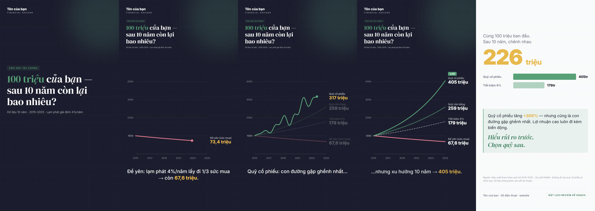
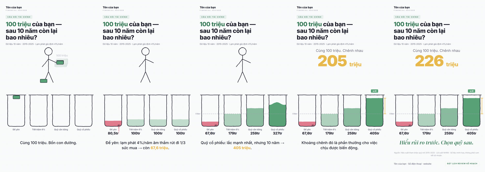
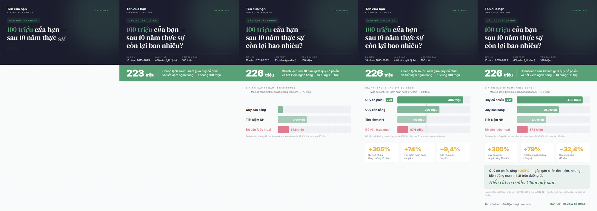
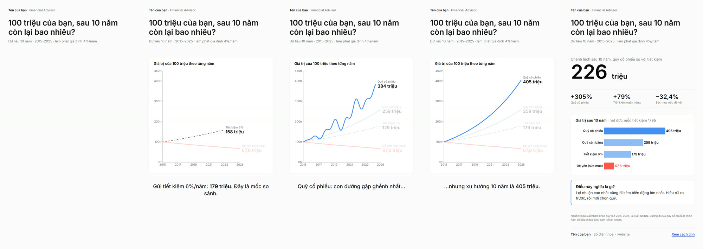
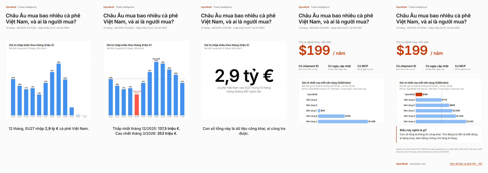
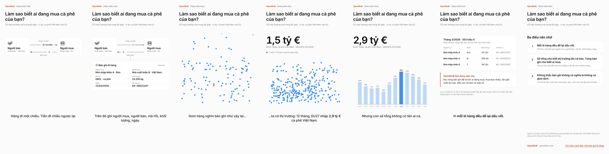

# Dalio-style data explainer — visual styles

Các mẫu video dọc (1080×1920, ~24 giây) kể cùng một câu chuyện tài chính theo cách Ray Dalio làm video giải thích:
**"100 triệu của bạn — sau 10 năm còn lại bao nhiêu?"**

Cùng kịch bản, cùng số liệu; chỉ khác ngôn ngữ hình ảnh. Mỗi mẫu là một file HTML chạy thẳng trên trình duyệt, không cần cài đặt.

## Xem

Mở `index.html` để xem các mẫu cạnh nhau. Mở từng file để xem toàn màn hình, có thanh tua, phím `Space` (dừng) và `R` (phát lại).

Tham số URL: `?embed` ẩn thanh điều khiển · `?t=12.5` dừng ở giây 12,5 (dùng để chụp khung hình).

## Các kiểu

### A · Biểu đồ là sân khấu — `a-bieu-do.html`
Theo *Principles for Dealing with the Changing World Order* (2023). Nền tối → sáng. Bốn đường vẽ dần, nhấn từng đường; quỹ cổ phiếu vẽ gập ghềnh rồi rút gọn thành xu hướng.



### B · Cỗ máy nét mảnh — `b-co-may.html`
Theo *How The Economic Machine Works* (2013). Người que, bốn cái lọ cùng xuất phát 100 triệu; lọ "để yên" rò vì lạm phát, lọ cổ phiếu sóng sánh rồi đứng ở 405.



### C · Poster động — `c-poster-dong.html`
Bố cục poster: header tối → dải số chính → thanh đơn sắc có mốc so sánh → stat cards → insight. Không minh họa.



### D · Kumo — `d-kumo.html`
Biểu đồ và màu theo [Kumo](https://kumo-ui.com/) của Cloudflare: ECharts + `ChartPalette`, biến màu Kumo, một font, không lưới, mọi giá trị in bằng chữ.



### E · OpenBtoB trên Kumo — `e-openbtob.html`
Câu chuyện sản phẩm trên dữ liệu thật: EU27 nhập bao nhiêu cà phê Việt Nam (Eurostat Comext qua API công khai của OpenBtoB, dữ liệu đến 31/07/2026), rồi "ai là người mua". Kumo xanh cho dữ liệu; cam OpenBtoB (`kumo/openbtob-brand.css`, cùng lớp ghi đè với production) chỉ đánh dấu những gì thuộc về OpenBtoB. Đối thủ được ẩn danh.



### F · Cỗ máy thương mại — `f-co-may-thuong-mai.html` (video kiến thức, 54 giây)
Cách kể của *How The Economic Machine Works* trên nền Kumo + cam OpenBtoB: một giao dịch (hàng đi, tiền về) → mỗi lô hàng để lại một bản ghi → khoảng 290 chấm bản ghi rơi xuống, tự xếp theo tháng thành biểu đồ thật (1 chấm ≈ 10 triệu €) → đi ngược từ số tổng về từng bản ghi để ra người mua → ba điều nên nhớ. Câu thần chú "Mỗi lô hàng đều để lại dấu vết" lặp ba lần. Bản ghi và tên công ty là minh họa; số tổng là dữ liệu thật.



## Nguyên tắc chung (mọi mẫu)

- Hỏi trước, đáp sau: mở bằng câu hỏi, không mở bằng sản phẩm.
- Một khung hình, một ý. Rút gọn dữ liệu ngay trước mắt người xem.
- Biểu đồ đơn sắc, tối đa một phần tử cảnh báo và luôn có nhãn chữ.
- Luôn có mốc so sánh, khoảng thời gian, nguồn và một câu "so what".
- Lời kêu gọi mang tính giáo dục, không bán hàng.
- Mọi màu đi qua biến CSS; biểu đồ canvas đọc màu từ token lúc chạy.

## Cấu trúc

```
index.html            so sánh các mẫu
a-*.html … f-*.html   các mẫu
common.js             engine thời gian: mỗi mẫu là hàm render(t)
common.css            token màu, khung 1080×1920, thanh điều khiển
brand.js              tên / vai trò / liên hệ hiển thị (placeholder)
kumo/                 phần dùng lại từ Kumo + alias nguyên tắc
previews/             khung hình xem trước
```

`render(t)` là hàm thuần theo thời gian, nên có thể chuyển sang Remotion (`frame / fps`) mà không đổi logic cảnh.

## Thông tin thương hiệu

`brand.js` chỉ chứa placeholder. Thông tin thật được thay vào lúc build (ví dụ một bước CI ghi đè file này từ biến môi trường), không commit vào repo.

## Số liệu

Minh họa. Giả định lãi kép cố định mỗi năm để khớp giá trị cuối kỳ: quỹ cổ phiếu 15%/năm → 405 triệu, quỹ cân bằng 10% → 259 triệu, tiết kiệm 6% → 179 triệu, sức mua với lạm phát 4% → 67,6 triệu. Đường gập ghềnh của quỹ cổ phiếu ở mẫu A và D là hình minh họa, không phải NAV thật. Không phải cam kết lợi nhuận.

## Ghi nhận

- Cách kể chuyện học từ hai video của Ray Dalio; repo không chứa nội dung của các video đó.
- `kumo/kumo-theme-base.css` và `kumo/chart-palette.js` lấy từ [cloudflare/kumo](https://github.com/cloudflare/kumo) `@cloudflare/kumo@2.14.0`, giấy phép MIT (`kumo/LICENSE-kumo`).
- [Apache ECharts](https://echarts.apache.org/) và font Google (Inter, DM Serif Display, Playfair Display) nạp qua CDN.
